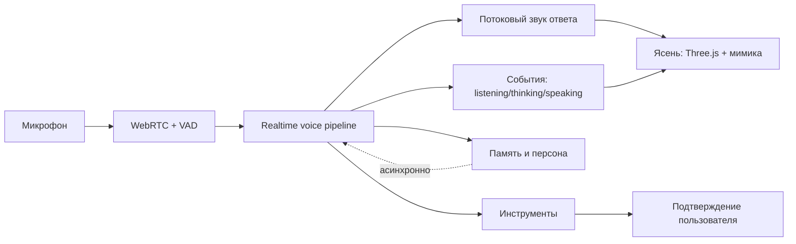

# Дорожная карта пилота моментального голоса

## Архитектура

## Этапы

1. **Базовые метрики — 1 день.** Инструментировать VAD, STT, запуск агента, первый токен, первый звук и полную
   длительность текущей реплики.
2. **Realtime-прототип — 2–3 дня.** Постоянная WebRTC-сессия, streaming audio, серверный или локальный VAD,
   отмена текущего ответа при перебивании.
3. **Интеграция с Ясенем — 3–4 дня.** События `listening`, `thinking`, `speaking`, `interrupted`, уровни звука,
   потоковые субтитры и обработка переподключения.
4. **Персона и память — 2–3 дня.** Короткий системный контекст на критическом пути; обновление долгой памяти после
   ответа, без блокировки следующей реплики.
5. **Умный визуальный слой — 2–3 дня.** Констелляция агентов/навыков по мотивам APEX-UI с собственным брендингом.
6. **Безопасность и пилот — 3–5 дней.** Loopback по умолчанию, короткоживущие токены, подтверждение инструментов,
   матрица ошибок и пользовательский прогон.

## Техническое решение первого спринта

- Не заменять Three.js-аватар нейросетевым talking-head: RX 580 4 ГБ не соответствует типичным требованиям
  современных CUDA-стеков цифрового человека.
- Вынести текущий последовательный `dialog.js` за интерфейс провайдера и сохранить как fallback.
- Добавить новый realtime-провайдер, не меняя контракт состояний аватара.
- Сравнить две реализации на одной таблице метрик: OpenAI Realtime и Pipecat pipeline.
- Выбрать победителя после 30 тестовых диалогов, а не по субъективному впечатлению.

## Приёмка

| Проверка | Порог |
| --- | --- |
| Время до первого звука | median ≤ 1,2 с; p95 ≤ 2 с |
| Перебивание | воспроизведение прекращается ≤ 250 мс |
| Переподключение | ≤ 3 с |
| Самопрослушивание | 0 циклов в тестовой сессии |
| Русская речь | 20 обычных реплик без зависания |
| Шум | 5 сценариев с фиксированным результатом |
| Fallback | текущий контур запускается при отказе realtime |

## Не входит в первый пилот

- фотореалистичная генерация лица на локальной RX 580;
- телефония и многопользовательские комнаты;
- автономные внешние действия без подтверждения;
- перенос кода Vach без полученной лицензии;
- полная замена текущего репозитория чужим фреймворком.
