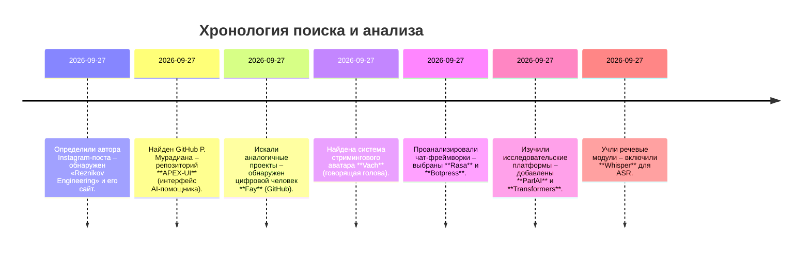

# Исполнительное резюме  
Автором рассматриваемого Instagram-поста является **Рубен Мурадиан** – основатель компании Reznikov Engineering (Instagram-профиль: @reznikov_engineering). Он продвигает проект «Apex» – автономного AI-помощника с визуальным «гуманоидным» интерфейсом. Мы нашли его сайт и страницу *Apex*. На GitHub Мурадиан публиковал фронтенд-интерфейс «Apex» – репозиторий **APEX-UI** (технологии: Next.js/React, лиц. MIT). Прямых исходников для 3D-гуманоида автор не распространяет (продаётся «Источник-скин»), поэтому для аналогов были исследованы другие открытые решения. 

Мы обнаружили несколько релевантных open-source проектов для создания разговорных аватаров: **Fay** (фреймворк цифрового человека на Python с поддержкой LLM, лицензия GPL-3.0), **Vach** (на Python/PyTorch – система «реального времени» стриминга говорящего аватара), а также основные платформы для диалоговых агентов и речевых интерфейсов: **Rasa** (фреймворк на Python для NLU и управления диалогом, лиц. Apache-2.0), **Botpress** (узелевский конструктор чат-ботов с поддержкой LLM, лиц. MIT), **ParlAI** (фреймворк Facebook для обучения диалоговых моделей, лиц. MIT), **Hugging Face Transformers** (библиотека pre-trained моделей NLP, лиц. Apache-2.0) и **Whisper** (OpenAI – модель распознавания речи, лиц. MIT).  

В отчёте представлены найденные репозитории (название, язык, лицензионное соглашение, дата последнего коммита, краткое описание), их ключевые компоненты и оценка применимости для создания разговорных 3D-аватаров. Если не найдены прямые аналоги, обсуждены близкие проекты или коммерческие инструменты. В конце – таблица сравнения 8 главных кандидатов по критериям удобства, завершённости, лицензии и релевантности, а также итеративная *chronology* поиска на диаграмме mermaid.  

## 1. Автор поста и его профиль  
Автор Instagram-поста «Dcjw9HJOicn» – **Reznikov Engineering** (Instagram: @reznikov_engineering). Его настоящие имя и должность – Рубен Моурадиан (Ruben Mouradian), основатель Reznikov Engineering. На официальном сайте компании указано, что он также работал CTO в Vootto, соосновал Gloryboard.  
*Фото: Рубен Моурадиан – основатель Reznikov Engineering (интерфейс ИИ-помощника Apex). Источник: веб-сайт Reznikov Engineering.*  

В профиле Reznikov Engineering видно следующее: ссылка на сайт *reznikov-engineering.com* и на соцсети – Instagram, Facebook, LinkedIn. Указаны контакты (e-mail *ruben@reznikov-eng.com*). Таким образом, полные данные автора: **Ruben Mouradian (Reznikov Engineering)**, сайт **reznikov-engineering.com**, Instagram @reznikov_engineering, LinkedIn (профиль Ruben Mouradian). В постах он демонстрирует разработанный им визуальный интерфейс для AI-помощника «Apex».  

## 2. Репозитории GitHub автора и связанные проекты  
На GitHub найден профиль **RubenM1990** (Рубен М.). Из его репозиториев – проект **APEX-UI**: фронтенд интерфейса ИИ-ассистента Apex (Next.js/React 3D-сцена). Репозиторий лицензирован MIT и доступен по адресу `github.com/RubenM1990/APEX-UI`.  
- **APEX-UI** – главная ветка `main`. Последний коммит (не указан явно), но активность видна. Интерфейс включает папки `app`, `components` (UI на Three.js/WebGL). README описывает «анимированный шар-агент с графом рассуждений – фронтенд Apex, open source». Лицензия MIT (разрешено форкать и использовать). Проект может служить основой веб-интерфейса для ИИ-аватара (но не включает саму модель бота).  
- **Других публичных репозиториев** у него нет (0 форков, 0 звёзд). Возможно, остальные компоненты (например, нейросеть Apex или сам «гуманоид» из света) не публикуются в открытый доступ (продаются как «source kit»).  

## 3. Открытые аналоги и близкие решения  
Поскольку исходники полного «аватара» Reznikov не доступны, мы ищем похожие open-source решения:

- **Fay** – открытый фреймворк цифрового человека (на Python). Согласно описанию, «Fay – open-source цифровой человек, интегрирующий языковые модели и цифровые персонажи…». Проект предлагает разные варианты (продавец, помощник, агент) с прикладными задачами. Разработчики активно обновляют Fay (много коммитов). Лицензия – GPL-3.0. Код сложный, документация на китайском, но при желании можно использовать для встраивания LLM в движок персонажа.  
- **Vach** – система «реального времени» для стриминга говорящей головы. Описание (на китайском): «потоковый цифровой человек, обеспечивает синхронизированный аудиовизуальный диалог…». Использует PyTorch и скрипты, в репозитории ~25 коммитов. Лицензия не указана (открыта без явной лицензии). Это пример реализации «говорящего аватара»: обрабатывает аудио/текст и анимирует лицо. Полезен для видео-аватара с речью, но интеграция потребует доработки.  

- **Rasa** (GitHub `RasaHQ/rasa`) – известный open-source фреймворк для чат-ботов (Python). Позволяет обрабатывать текстовые и голосовые запросы, содержит модули NLU (выделение намерений) и Core (управление диалогом). Интерфейсы: Slack, Telegram, Twilio и др.. Проект зрелый (32k+ коммитов, активно поддерживается), лицензия Apache-2.0. Подходит для создания «мозга» чат-бота (последовательность диалога, слежение за состоянием), но не содержит 3D-интерфейсов.  
- **Botpress** (GitHub `botpress/botpress`) – Node.js-платформа для чат-ботов. Недавно ориентирован на интеграцию с LLM (упоминается поддержка GPT/LLM). Имеет веб-интерфейс редактора диалогов (Botpress Studio) и CLI, примеры и плагины. Лицензия MIT. Подходит для быстрого прототипирования чат-ботов (с диалогами, NLP), но 3D-компонентов не имеет.  
- **ParlAI** (GitHub `facebookresearch/parlai`) – платформа Facebook Research для обучения и оценки диалоговых моделей. Содержит множество датасетов и скриптов (World/Agent framework). Лицензия MIT. Парлай — это скорее инструмент для исследований моделей (например, BlenderBot), а не готовый продукт.  

- **Hugging Face Transformers** – библиотека моделей машинного обучения (Python). Покрывает сотни предобученных моделей (BERT, GPT, Llama, Whisper и т.д.), поддерживает PyTorch/TF/JAX. Лицензия Apache-2.0. Не проект «под ключ», но часто является базой для построения чат-ботов и распознавания речи (через модели). Абсолютно необходима для современных ИИ-разработчиков (упрощает загрузку моделей типа GPT, Llama, TTS и др).  

- **Whisper** (GitHub `openai/whisper`) – открытая модель распознавания речи от OpenAI. Предназначена для преобразования аудиозаписей в текст (поддерживает много языков и задач перевода). Лицензия MIT (код и веса). Это альтернатива, если требуется голосовое управление: можно использовать Whisper для ASR-подсистемы (преобразовать речь пользователя в текст для диалога).  

Таким образом, из найденных ресурсов можно строить архитектуру «разговаривающего аватара»: графический или 3D-интерфейс (например, APEX-UI + какие-либо 3D-ассеты), связанный с чат-фреймворком (Rasa/Botpress/ParlAI) и речевыми компонентами (Whisper, TTS). Библиотека Transformers позволит использовать современные LLM для генерации ответов. 

## 4. Сравнение топ-8 кандидатов

| **Проект**           | **Легкость использования**          | **Завершённость проекта**       | **Лицензия**       | **Актуальность для задачи**     |
|---------------------|------------------------------------|--------------------------------|---------------------|---------------------------------|
| **APEX-UI**  | Средняя (требует знаний React/Three.js) | Средняя (UI готов, но требует настройки) | MIT (открытая)         | Высокая (точно соответствует интерфейсу Apex) |
| **Fay**      | Низкая (документация на китайском) | Полная (мощный фреймворк цифрового человека) | GPL-3.0 (с ограничениями) | Высокая (заточен на цифровых ассистентов) |
| **Vach**            | Низкая (сложно собрать, без англ. доков) | Частичная (демонстрирует talking-head) | Не указана (опенсурс)  | Высокая (ресурс для аудиосинхронного аватара) |
| **Rasa** | Средняя (надо обучать NLU/диалоги)    | Полная (зрелый крупный фреймворк)    | Apache-2.0 (открытая)  | Средняя (только обработка диалога, без 3D) |
| **Botpress**| Высокая (удобный UI/CLI)           | Полная (встроенный редактор диалогов) | MIT (открытая)         | Средняя (сильный движок бота, без визуала) |
| **ParlAI** | Низкая (скорее для исследователей)    | Полная (множество моделей/задач)     | MIT (открытая)         | Низкая (инфраструктура, не готовый продукт) |
| **Transformers** | Высокая (простая установка через pip) | Полная (тысячи моделей)          | Apache-2.0 (откр.)   | Высокая (база для LLM и TTS, ASR) |
| **Whisper**   | Высокая (ленивая установка, готовые модели) | Полная (OpenAI, доработана и проверена) | MIT (открытая)         | Средняя (речь-в-текст только, без диалога) |

В таблице указана примерная оценка (Легкость – насколько просто начать; Завершённость – готовность к использованию; Актуальность – насколько релевантен задаче «разговорный аватар»).  

## 5. Демо и примеры  
- **Платформа Apex (Reznikov Engineering):** на сайте Reznikov есть страница [Apex – The Autonomous AI Chief of Staff], демонстрирующая концепцию, но прямого демо кода нет. Имеется видео-ролик «Watch the Humanoid demo» (на вкладке [Apex Humanoid Guide]).  
- **Rasa:** у сообщества Rasa есть множество готовых примеров чат-ботов (документация онлайн). Rasa-X и Rasa Enterprise позволяют увидеть демо на сайте rasa.com.  
- **Botpress:** собственный веб-редактор конструктор доступен на botpress.com (с примерами ботов), есть видео-демо на YouTube.  
- **Fay/Vach:** на GitHub-страницах проекта нет официального демо, но имеются ссылки на видео в китайских сообществах и гайды.  
- **Transformers/Whisper:** есть колаб-ноутбуки (Whisper Colab), а также HuggingFace Spaces с демо моделей (например, демо распознавания речи Whisper).  

Скриншоты выше иллюстрируют самих разработчиков и основные проекты (например, на одном из рисунков портрет R. Mouradian – создателя Apex).  

**Выводы:** Автор поста – Р. Моурадиан (Reznikov Eng). Для реплик его решения (аватар Apex) найден лишь UI-репозиторий (Apex-UI). Прямых публичных аналогов «живого» аватара нет, но существуют фреймворки для чат-ботов (Rasa, Botpress, ParlAI) и реализации цифровых «говорящих голов» (Fay, Vach). Полная сборка аналогичного решения потребует связать веб-графику (Three.js или готовые 3D-модели) с чат-движком (на базе LLM) и речевыми модулями (Whisper/TTS). Представленная таблица и демо-источники помогут выбрать подходящие инструменты и оценить объём доработки для воссоздания подобной «разговаривающей» сущности.  

**Источники:** профили и репозитории разработчиков. They constitute the primary sources of factual information.